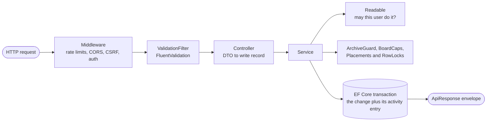

# Architecture

This page is a map of the code. It names the folders, the path a request takes, and the rules the code keeps everywhere. Search for the type names it gives. [GLOSSARY.md](GLOSSARY.md) defines the domain words, and [docs/adr](docs/adr) records why things are the way they are.

## Bird's-eye view

Laneway is one ASP.NET Core app on .NET 10 with one PostgreSQL database. It has no message broker and no second service. Background work runs in hosted services inside the same process, and the database is the queue.

A request goes through a controller, a service, and EF Core. The controller binds the body to a DTO and maps it to a write record. The service checks who may do it, checks the rules, and saves everything in one transaction. The response always comes back in the same envelope.

## Codemap

### `Program.cs`

Wires every service, filter, and hosted service. It refuses to start without a connection string, and it refuses one that sets `Include Error Detail`.

### `Features/<Slice>/`

One folder per area of the product: `Account`, `Activity`, `Attachment`, `Auth`, `Board`, `Card`, `CheckItem`, `Checklist`, `Comment`, `CopyJob`, `Label`, `List`, `Membership`, `Message`, `User`, and `WorkSpace`. A slice holds its own files, named after the slice:

- `<Slice>Controller.cs` maps routes to service calls and holds no rules.
- `<Slice>Dtos.cs` holds the request and response shapes.
- `<Slice>Validators.cs` holds the FluentValidation rules for the request DTOs.
- `<Slice>Writes.cs` holds the write records a controller builds from a DTO, such as `CreateCardWrite`. A service takes a write record, never a DTO.
- `<Slice>Service.cs` holds the interface and the class that does the work.
- The entity, such as `Card.cs`.

`Membership` also holds `Readable`, the authorization queries every other slice calls. `Message` holds the outgoing email queue and the Brevo webhook. `CopyJob` holds the worker that runs list and board copies.

### `Shared/`

Code more than one slice uses. The files worth knowing first:

- `ApplicationDbContext.cs`: the one `DbContext`.
- `ApiResponse.cs`, `ApiError.cs`, `ErrorCodes.cs`: the response envelope and the error codes clients read.
- `ApiExceptionHandler.cs`: turns an unhandled exception into a 500 envelope with a trace id.
- `ValidationFilter.cs`, `ValidationRules.cs`, `FieldLimits.cs`: request validation.
- `Placements.cs`, `Placement.cs`, `PositionValue.cs`: where a list or card lands.
- `RowLocks.cs`: row locks taken through no-op updates in LINQ.
- `Archive.cs`: the archive filters and the archive errors.
- `TelemetryPipeline.cs`, `SpanScrub.cs`, `RequestScopeScrub.cs`: the OTLP pipeline and what it strips from logs and spans.
- `HttpHardening.cs`: security headers, the CSP, and forwarded headers.

### `Migrations/`

EF Core migrations. [docs/migrations.md](docs/migrations.md) has the rules every migration follows so a deploy can't break the release still serving.

### `tests/Laneway.Api.Tests/`

One xUnit project of integration tests. `TestStack` starts `postgres:18` in Testcontainers, and the tests call the API over HTTP. The `*AccessTests` classes build on `AccessMatrix`, which runs each route once for every kind of caller and checks who gets through. `AnonymousAccessTests` walks every mapped route and fails if one outside its allowlist takes an anonymous request.

### `terraform/`

Three roots. `vm` builds the Oracle Cloud VM, `alerting` holds the Grafana alert rules, and `oci-bootstrap` sets up the OCI compartment and the identity federation CI signs in with. [docs/runbooks/terraform.md](docs/runbooks/terraform.md) covers them.

### `deploy/vm/`

The pinned image digests the VM runs: Postgres, cloudflared, and the OCI CLI.

### `supabase/`

The local Supabase stack config. Production uses Supabase for attachment storage only.

## Invariants

These hold everywhere in the code today.

- **Services do the authorization.** Every route needs a signed-in user unless it opts out with `AllowAnonymous`. A service then asks `Readable` whether that user may act on that item, and returns the denial if not. No controller names a role or a policy. [ADR 0007](docs/adr/0007-hand-written-authorization-in-services.md) says why.
- **A change and its activity entry commit together.** A service opens a transaction, writes the change, adds the activity entry through `ActivityWriter`, and commits once.
- **A position is only an order.** `Placements` turns `top`, `bottom`, or a `before` or `after` neighbor into a number with gaps of 65536 between items. Placing locks the board and list rows first, so two moves at once can't land on the same spot.
- **Archived items are read-only.** Writes to an archived item, or creates under one, fail with an error from `ArchiveErrors`.
- **One envelope.** Every response, success or error, is an `ApiResponse<T>` with `success`, `message`, `data`, `statusCode`, and `errors`.

## Cross-cutting concerns

- **Background work.** `CopyJobWorker` runs list and board copies, [ADR 0003](docs/adr/0003-list-and-board-copies-run-as-background-jobs.md). `DeliveryWorker` sends queued email through Brevo. `SessionSweeper`, `AuthSweeper`, and `InviteSweeper` delete expired rows. `PendingObjectDrainer` deletes storage objects queued for deletion and retries a failed batch on its next run.
- **Rate limits.** `Features/Auth/RateLimits.cs`. [docs/security/rate-limits.md](docs/security/rate-limits.md) lists each limit.
- **Telemetry.** Serilog in front of the OpenTelemetry SDK, [ADR 0011](docs/adr/0011-serilog-in-front-of-the-otel-sdk.md). [docs/security/logging-inventory.md](docs/security/logging-inventory.md) lists what gets logged and what never does.
