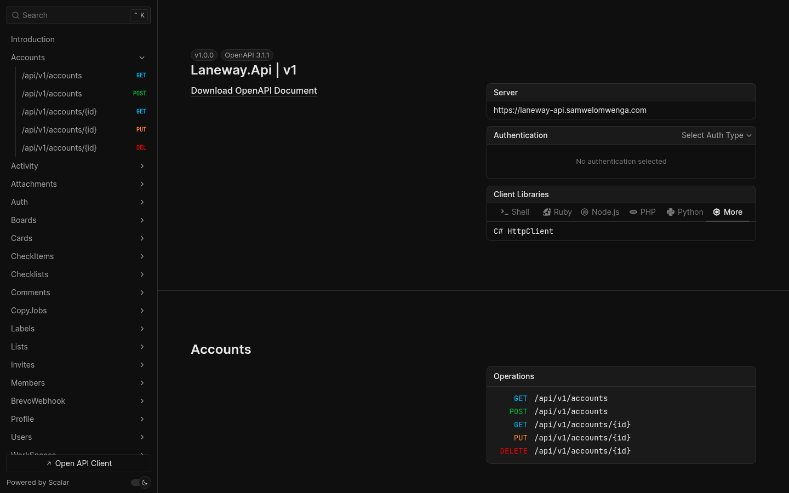
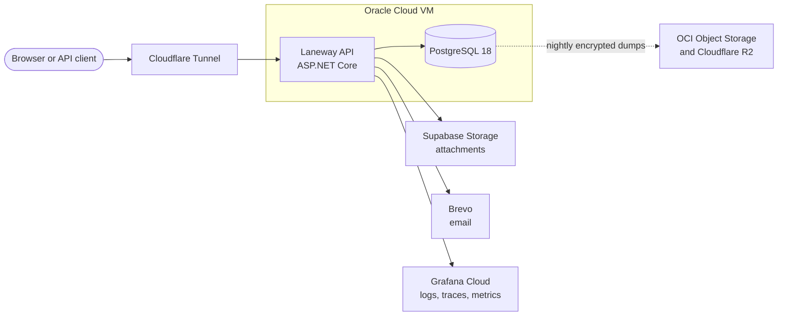

# Laneway API

A REST API for a kanban board app, built with ASP.NET Core on .NET 10 and PostgreSQL.

[Live API](https://laneway-api.samwelomwenga.com) · [API reference](https://laneway-api.samwelomwenga.com/scalar/v1) · [Architecture](ARCHITECTURE.md) · [Frontend repo](https://github.com/Samwelomwenga/laneway-ui)

[](https://github.com/Samwelomwenga/laneway-api/actions/workflows/main.yml)
[](https://github.com/Samwelomwenga/laneway-api/actions/workflows/deploy.yml)
[](LICENSE)

## Why I built this

I wanted one project that goes all the way from domain model to production, the parts tutorials skip included. That meant authorization that holds up against a test of every route, a security target I could point to, real email, telemetry, alerts, backups, and a deploy pipeline I run myself. Laneway works the way a familiar kanban tool works, so the product questions have known answers and the work goes into the engineering.

You can sign up through the live API with a real inbox. Laneway sends a verification email before the first sign-in.



## Features

- Workspaces, boards, lists, and cards. Lists and cards keep their order, and a move takes a card to another list, a list to another board, or a board to another workspace.
- Copies of cards, lists, and boards. List and board copies run as background jobs that the client polls.
- Labels, checklists, comments, cover images, and file attachments up to 10 MB.
- Workspace and board members with roles. Inviting an address no user has yet makes an invite, and it becomes a membership once someone verifies that address.
- An activity history you can read for a workspace, board, list, or card. It stays after the item is deleted.
- Accounts with email verification, session management, refresh token rotation, and a check against breached passwords.

## Architecture



The VM has no inbound port. Traffic reaches it through a Cloudflare Tunnel, and the only admin access is Tailscale SSH. [ARCHITECTURE.md](ARCHITECTURE.md) maps the code: the folders, the path a request takes, and the rules the code keeps everywhere.

## Design decisions

The [ADRs](docs/adr) record each decision and the options it beat. These are the ones I'd read first:

- [Authorization is hand-written in the services](docs/adr/0007-hand-written-authorization-in-services.md). One LINQ expression per entity decides both the 404 and the list filter. OpenFGA and OPA would each have meant a second system to keep in sync.
- [Auth targets OWASP ASVS 5.0 Level 2](docs/adr/0004-auth-targets-asvs-l2-with-exceptions.md). Every L2 item Laneway doesn't meet is listed with the reason and what makes up for it.
- [List and board copies run as background jobs](docs/adr/0003-list-and-board-copies-run-as-background-jobs.md). A big copy can take minutes, too long for a request to wait. Card copies stay in the request because they're small and common.
- [Comments are activity entries that outlive their items](docs/adr/0002-activity-entries-hold-comments-and-outlive-items.md). A card's comments and history read through one route and survive the card's deletion.
- [Production Postgres runs in a container on the VM](docs/adr/0013-production-postgres-runs-in-a-container-on-the-vm.md). It was the only free option that stays up all month. The cost is running backups myself.
- [Telemetry goes to Grafana Cloud](docs/adr/0012-grafana-cloud-for-telemetry-without-sentry.md). It was the only free tier that takes logs, traces, and metrics in the EU with enough alert rules.

## Tech stack

| Layer | Choice |
| --- | --- |
| API | ASP.NET Core on .NET 10, controllers, FluentValidation |
| Data | PostgreSQL 18 through EF Core 10 and Npgsql |
| Auth | JWT access tokens and rotating refresh tokens in a cookie |
| Files | Supabase Storage for attachments |
| Email | Brevo transactional API, with a webhook for bounces |
| Observability | Serilog and OpenTelemetry over OTLP to Grafana Cloud |
| API docs | OpenAPI document rendered by Scalar |
| Tests | xUnit, Testcontainers for PostgreSQL |
| Infrastructure | Terraform, Docker Compose, Oracle Cloud, Cloudflare Tunnel, Tailscale |
| Secrets | Doppler |

## Engineering highlights

- Integration tests run against a real Postgres 18 in Testcontainers. The access tests run each route once for every kind of caller.
- Every PR runs CodeQL, Trivy, gitleaks, a vulnerable package check, and zizmor over the workflows.
- Releases build an arm64 image with SLSA provenance and a CycloneDX SBOM, and deploy to the VM from GitHub Actions.
- Terraform manages the VM and the Grafana alert rules. Each alert links to a playbook in [docs/runbooks/alerts](docs/runbooks/alerts).

## Running locally

You need the .NET 10 SDK, Docker, the Supabase CLI, and the Doppler CLI.

```sh
doppler setup --project laneway-api --config dev
supabase start
doppler run -- dotnet ef database update --project Laneway.Api.csproj
doppler run -- dotnet run
```

Then open http://localhost:5062/scalar/v1. To run the tests:

```sh
DOTNET_USE_POLLING_FILE_WATCHER=1 dotnet test Laneway.Api.sln
```

[docs/local-development.md](docs/local-development.md) lists the variables to set without Doppler and covers local telemetry.

## Documentation

- [ARCHITECTURE.md](ARCHITECTURE.md): the codemap and the rules the code keeps
- [GLOSSARY.md](GLOSSARY.md): the domain words
- [docs/adr](docs/adr): architecture decision records
- [docs/local-development.md](docs/local-development.md): running the API and the tests
- [docs/ci.md](docs/ci.md): each CI check and how to fix it
- [docs/migrations.md](docs/migrations.md): the rules every migration follows
- [docs/runbooks](docs/runbooks): the VM, backups, Brevo, Grafana, alerting, signing keys, and the rest

## License

[MIT](LICENSE)
